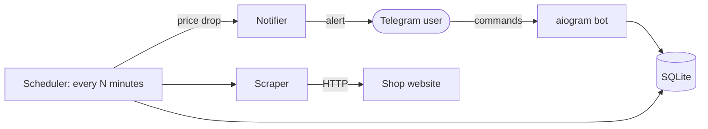

# Price Monitor


A Telegram bot that tracks product prices and sends an alert when a price drops.
Built with Python, aiogram, SQLite and Docker.

> Demo target: [books.toscrape.com](https://books.toscrape.com), a sandbox site made for scraping practice.

## Features

- `/add URL [target price]` starts tracking a product. With a target price, you are alerted only when the price reaches it; without one, on any drop.
- `/list` shows your tracked products, `/remove ID` stops tracking one.
- `/export` sends the full price history as a CSV file.
- Prices are checked in the background on a schedule (default: every 60 minutes) and every check is stored as price history.
- Runs in Docker with a persistent volume for the database.

## How it works



The bot and the scheduler run in one `asyncio` process. Blocking network calls run in worker threads, while all database access stays on the main thread.

## Screenshots

| Add a product | Price drop alert |
|---|---|
|  |  |

## Quick start (Docker)

1. Create a bot with [@BotFather](https://t.me/BotFather) and copy its token.
2. Clone the repository and create the settings file:

   ```bash
   git clone https://github.com/Denys33546/price-monitor.git
   cd price-monitor
   cp .env.example .env
   ```

3. Put your token into `.env`:

   ```
   BOT_TOKEN=your-token-here
   CHECK_INTERVAL_MINUTES=60
   ```

4. Start the bot:

   ```bash
   docker compose up --build
   ```

The database is stored in the `price_data` Docker volume and survives restarts.
`docker compose down -v` deletes it.

## Run locally (without Docker)

Requires Python 3.12.

```bash
python -m venv .venv
source .venv/bin/activate
pip install -r requirements-dev.txt
cp .env.example .env   # then set BOT_TOKEN
python -m app.main
```

## Configuration

| Variable | Default | Description |
|---|---|---|
| `BOT_TOKEN` | none (required) | Telegram bot token from @BotFather |
| `CHECK_INTERVAL_MINUTES` | `60` | How often prices are checked |
| `DB_PATH` | `price_monitor.db` | SQLite database file (`/data/price_monitor.db` in Docker) |

## Tests and code quality

```bash
pytest --cov            # tests with coverage
ruff check .            # lint
ruff format --check .   # formatting
```

Tests run without network access: HTTP calls and the Telegram API are replaced with fakes.

## Security notes

- Only whitelisted hosts can be tracked (`ALLOWED_HOSTS`), so users cannot make the server request arbitrary or internal URLs (SSRF).
- Product titles from websites are HTML-escaped in messages and neutralised in CSV exports (formula injection).
- Each user sees and manages only their own products, with a limit of 20 per user.
- The container runs as a non-root user, and the bot token is passed at runtime, never baked into the image.

## Project structure

```
app/
├── main.py            # entry point: bot + background price checks
├── bot.py             # Telegram command handlers
├── scheduler.py       # periodic price checks
├── notifications.py   # price drop rules and alert messages
├── scraper.py         # fetches title and price from a product page
├── db.py              # SQLite storage: products and price history
└── config.py          # settings from environment variables
tests/                 # pytest test suite
Dockerfile
docker-compose.yml
```

## Limitations

- The scraper currently has a parser for `books.toscrape.com` only. To support another shop, add a parser for its HTML and add its host to `ALLOWED_HOSTS` in `app/bot.py`.
- SQLite fits a single bot instance; a larger deployment would move to PostgreSQL.

## Roadmap

- [x] Scraper, SQLite storage, Telegram commands
- [x] Price drop alerts
- [x] Tests, linting, coverage
- [x] Docker and Docker Compose
- [ ] GitHub Actions CI (lint, tests, Docker build)
- [ ] Parsers for more shops

## License

MIT, see [LICENSE](LICENSE).
